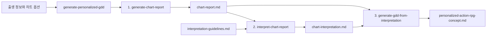

# 개인화 GDD 생성 파이프라인

## 목적

사용자가 제공한 출생 정보를 결정론적 차트 보고서, 창작용 해석, 개인화 액션 RPG GDD로 순차 변환한다. 계산·해석·설계를 서로 다른 단계로 격리하여 이전 대화나 과거 버전의 산출물이 결과에 섞이지 않도록 한다.

## 전체 흐름



오케스트레이터는 세 단계를 `fork_turns="none"`인 격리 에이전트에서 순차 실행한다. 한 단계가 성공하고 검증을 통과해야 다음 단계로 진행한다.

## 입력과 기본값

필수 사용자 입력은 생년월일, 정확한 출생 시각, 도시 수준의 출생지, 성별이다. 차트 단계는 도시의 대표 좌표와 IANA 시간대를 해석하며, 지명이 모호할 때만 사용자에게 확인한다.

명시하지 않은 옵션에는 다음 기본값을 적용한다.

| 옵션 | 기본값 | 의미 |
| --- | --- | --- |
| `mode` | `light` | 해석과 GDD의 분량 및 깊이 |
| `flow-year` | 실행 시점의 연도 | 자미두수 유년 계산 연도 |
| `jasi-method` | `unified` | 사주 자시 처리 방식 |
| `house-system` | `P` | 서양 점성술 Placidus 하우스 |

`mode`는 `light`와 `deep`만 지원한다.

## 버전과 출력 경로

오케스트레이터는 생성 전에 `resolve-output.ts`로 새 시맨틱 버전을 할당한다. 버전을 지정하지 않으면 `artifacts/`에서 가장 큰 버전의 패치 번호를 하나 올리며, 버전이 하나도 없으면 `v0.1.0`부터 시작한다. 이미 존재하는 버전 디렉터리는 재사용하거나 덮어쓰지 않는다.

```text
artifacts/vX.Y.Z/docs/GDD/
├── chart-report.md
├── chart-interpretation.md
└── personalized-action-rpg-concept.md
```

새 버전을 정할 때 기존 산출물의 내용은 읽지 않는다.

## 단계 1: 차트 보고서 생성

담당 스킬은 `generate-chart-report`다.

입력:

- 사용자가 제공한 출생 정보
- 기본값을 포함해 정규화한 모든 차트 옵션
- 저장소 루트, 버전, 정확한 출력 경로

처리:

1. 도시를 대표 좌표와 시간대로 정규화한다.
2. `scripts/chart-report.ts`를 실행한다.
3. 계산기의 표준 출력을 수정하지 않고 `chart-report.md`로 저장한다.
4. 사주팔자, 자미두수, 서양 네이탈 차트 세 섹션이 모두 있는지 확인한다.

이 단계는 차트를 해석하거나 요약하지 않는다. 필수 입력이 없거나 계산이 실패하면 파이프라인을 중단한다.

## 단계 2: 차트 해석 생성

담당 스킬은 `interpret-chart-report`다.

입력:

- `chart-report.md`
- [`docs/prompts/interpretation-guidelines.md`](../prompts/interpretation-guidelines.md)
- 스킬 내부의 `interpretation-format.md`
- 선택한 모드의 `light-mode.md` 또는 `deep-mode.md`
- 정확한 해석 출력 경로

처리:

1. 차트의 직접 관찰과 교차 체계 종합을 구분한다.
2. 주요 종합마다 원본 차트의 라벨이나 값을 `근거:`로 남긴다.
3. 충돌과 불확실성을 임의로 해소하지 않는다.
4. 후속 GDD에서 인용할 수 있는 인물·갈등·관계·진행·환경·미학 모티프를 만든다.
5. 정해진 섹션 계약에 맞춰 `chart-interpretation.md`를 저장한다.

이 단계에는 원시 출생 정보나 대화 문맥을 전달하지 않는다. 현실의 성격 진단, 운명 예측, 조언 또는 구체적인 게임 설계도 수행하지 않는다.

## 단계 3: GDD 생성

담당 스킬은 `generate-gdd-from-interpretation`이다.

입력:

- `chart-interpretation.md`
- 근거 확인용 `chart-report.md`
- 스킬 내부의 `design-prompt.md`
- 선택한 모드의 `light-mode.md` 또는 `deep-mode.md`
- 정확한 GDD 출력 경로

처리:

1. 해석 문서를 주 설계 브리프로 사용한다.
2. 차트 보고서는 인용 근거 확인과 해석 이탈 방지에만 사용한다.
3. 주요 개인화 설계 뒤에 해석 원문의 짧은 구절을 `해석 모티프:`로 인용한다.
4. 차트 보고서와 해석 문서를 첨부하지 않고 `personalized-action-rpg-concept.md`로 저장한다.

이 단계는 차트를 다시 계산하거나 독자적으로 재해석하지 않는다. 완전한 해석 문서는 GDD에 첨부하지 않는다.

## 단계 격리와 데이터 전달

| 데이터 | 차트 생성 | 차트 해석 | GDD 생성 |
| --- | :---: | :---: | :---: |
| 원시 출생 정보 | 전달 | 미전달 | 미전달 |
| 차트 옵션 | 전달 | 미전달 | 미전달 |
| `chart-report.md` | 생성 | 읽기 | 근거 확인 |
| `interpretation-guidelines.md` | 미전달 | 읽기 | 미전달 |
| `chart-interpretation.md` | 미전달 | 생성 | 주 설계 입력 |
| 대화 문맥과 과거 산출물 | 미전달 | 미전달 | 미전달 |

각 단계에는 필요한 정확한 경로와 해당 스킬 경로만 전달한다. 다른 아티팩트를 검색하거나 이전 버전을 참고하지 않는다.

## 모델 선택

| 단계 | `light` | `deep` |
| --- | --- | --- |
| 차트 생성 | `gpt-5.6-terra`, low | `gpt-5.6-terra`, low |
| 차트 해석 | `gpt-5.6-terra`, low | `gpt-5.6-sol`, high |
| GDD 생성 | `gpt-5.6-terra`, low | `gpt-5.6-sol`, high |

지정 모델을 사용할 수 없으면 가장 가까운 모델로 대체하고 최종 결과에 대체 여부를 보고한다.

## 검증과 실패 처리

차트 단계는 계산 결과에 세 차트 체계가 모두 존재하는지 확인한다. 해석 단계는 필수 섹션의 순서와 `근거:` 존재 여부를 검사한다. GDD 단계는 다음을 검사한다.

- GDD와 두 원본 입력이 비어 있지 않은가
- 차트 보고서 전체가 GDD에 중복 포함되지 않았는가
- 모든 `해석 모티프:` 문구가 해석 원문에 실제로 존재하는가

해석과 GDD 단계는 자체 검증 실패 시 현재 출력만 한 번 수정하고 재검증할 수 있다. 두 번째 실패는 그대로 반환한다. 세 단계가 끝나면 오케스트레이터가 해석과 GDD 검증을 다시 실행한다. 최종 검증 실패 시 실패한 단계와 원문 오류를 보고하며, 이미 유효한 단계의 결과를 임의로 다시 쓰지 않는다.

## 완료 결과

성공 시 사용자에게 다음 정보만 보고한다.

- 선택한 `mode`
- 할당된 버전
- 검증된 세 산출물의 경로
- 모델 대체 여부

출생 정보, 차트 내용, 해석 내용, GDD 본문은 완료 메시지에 복제하지 않는다.
