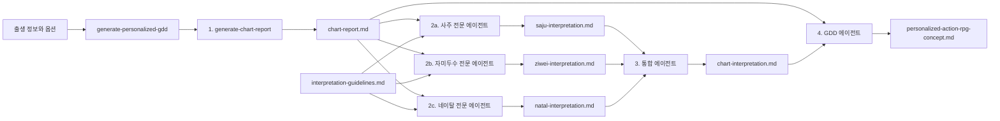

# 개인화 GDD 생성 파이프라인

## 목적

출생 정보를 결정론적 차트 보고서로 계산한 뒤, 세 체계를 서로 격리된 전문 에이전트가 깊이 해석한다. 통합 에이전트는 전문 해석 사이의 일관성·구체화·상충을 정리하고, GDD 에이전트는 그 통합 문서만을 주 설계 브리프로 사용한다.

## 전체 흐름



세 전문 에이전트는 차트 보고서 생성 후 동시에 실행한다. 서로의 결과를 보지 않으며, 셋이 모두 검증을 통과한 뒤에만 통합 에이전트를 실행한다. 모든 에이전트는 `fork_turns="none"`으로 격리한다.

## 입력과 기본값

필수 입력은 생년월일, 정확한 출생 시각, 도시 수준 출생지, 성별이다. 지명이 모호할 때만 사용자에게 확인한다.

| 옵션 | 기본값 | 의미 |
| --- | --- | --- |
| `mode` | `light` | 전문 해석·통합·GDD의 분량과 깊이 |
| `flow-year` | 실행 연도 | 자미두수 유년 계산 연도 |
| `jasi-method` | `unified` | 사주 자시 처리 방식 |
| `house-system` | `P` | 서양 점성술 하우스 시스템 |

## 버전과 출력

새 시맨틱 버전을 할당하며 기존 버전을 읽거나 덮어쓰지 않는다.

```text
artifacts/vX.Y.Z/docs/GDD/
├── chart-report.md
├── saju-interpretation.md
├── ziwei-interpretation.md
├── natal-interpretation.md
├── chart-interpretation.md
└── personalized-action-rpg-concept.md
```

## 단계 1: 차트 보고서

`generate-chart-report`가 사주팔자, 자미두수, 네이탈 차트를 계산해 `chart-report.md`에 그대로 저장한다. 해석이나 요약은 하지 않는다.

## 단계 2: 전문 해석 병렬 실행

세 `interpret-chart-system` 에이전트가 같은 보고서에서 지정된 체계만 읽는다.

### 사주팔자

원국과 십신에 한정하지 않는다. 계산 전제, 네 기둥과 지장간·운성·공망, 모든 팔자 관계, 신살, 좌법, 인종법, 전체 대운을 다룬다. 보고서에 출력되지 않은 격국·신강약·용희신 등을 계산된 사실처럼 보충하지 않는다. 결과는 `saju-interpretation.md`이며 항목 ID는 `S-01`부터 시작한다.

### 자미두수

계산 전제, 명궁·신궁·오행국, 12궁의 모든 성요와 밝기·사화, 본명 사화, 전체 대한, 조회 유년과 12유월을 다룬다. 본명·대한·유년·유월 층위를 섞지 않는다. 결과는 `ziwei-interpretation.md`이며 ID는 `Z-01`부터 시작한다.

### 네이탈 차트

계산 전제, 출력된 앵글과 하우스, 모든 행성·노드·조건부 포인트, 별자리·도수·역행·하우스, 모든 주요 애스펙트와 오브를 다룬다. 출생 시각 미상이나 조건부 천체의 부재를 임의로 채우지 않는다. 결과는 `natal-interpretation.md`이며 ID는 `N-01`부터 시작한다.

각 전문 문서는 직접 관찰과 해석을 구분하며 현실의 성격 진단, 운명 예측, 조언, 게임 설계를 하지 않는다. 또한 원문 각 데이터 행의 공백을 정규화한 `원문 항목 검토표`를 남기고, 조건부 항목이 없으면 `보고서에 없음:`으로 명시한다.

## 단계 3: 통합 해석

`interpret-chart-report` 통합 에이전트는 세 전문 문서만 읽고 `chart-interpretation.md`를 만든다. 원본 보고서를 다시 해석하지 않는다.

통합 관계는 다음 세 종류로 분류한다.

- `일관`: 둘 이상의 체계가 유사한 방향을 독립적으로 지지한다.
- `구체화`: 한 체계의 넓은 해석을 다른 체계가 조건·영역·작동 방식으로 구체화한다.
- `상충`: 전제나 방향이 달라 하나의 결론으로 합치기 어렵다.

통합 항목은 `I-01`부터 시작하며 `관계:`, `해석:`, `근거:`를 포함한다. 근거는 실제 `S-`, `Z-`, `N-` ID만 참조한다. 상충은 임의로 화해시키지 않는다.

## 단계 4: GDD

`generate-gdd-from-interpretation`은 통합 해석을 주 설계 브리프로, `chart-report.md`를 근거 확인용으로만 사용한다. GDD에는 원본 보고서나 해석 문서를 첨부하지 않는다.

## 데이터 격리

| 데이터 | 차트 생성 | 전문 3개 | 통합 | GDD |
| --- | :---: | :---: | :---: | :---: |
| 원시 출생 정보·옵션 | 읽기 | 미전달 | 미전달 | 미전달 |
| `chart-report.md` | 생성 | 각자 지정 체계 읽기 | 미전달 | 근거 확인 |
| 전문 해석 3개 | 미전달 | 각자 생성·상호 미전달 | 읽기 | 미전달 |
| `chart-interpretation.md` | 미전달 | 미전달 | 생성 | 주 입력 |
| 대화 문맥·과거 산출물 | 미전달 | 미전달 | 미전달 | 미전달 |

## 모델 선택

| 단계 | `light` | `deep` |
| --- | --- | --- |
| 차트 생성 | `gpt-5.6-terra`, low | `gpt-5.6-terra`, low |
| 전문 해석 3개 | `gpt-5.6-terra`, low | `gpt-5.6-sol`, high |
| 통합 해석 | `gpt-5.6-terra`, low | `gpt-5.6-sol`, high |
| GDD | `gpt-5.6-terra`, low | `gpt-5.6-sol`, high |

## 검증과 실패 처리

각 전문 문서는 원본 보고서에 실제 출력된 체계별 섹션·행 식별자의 포함 여부, 순차 ID, `해석:`과 `근거:`를 검증한다. 통합 문서는 세 비교 분류, 순차 ID, 관계 유형, 서로 다른 두 체계 이상의 실제 전문 ID 참조를 검증한다. GDD는 통합 ID 추적성과 원본 보고서 비첨부를 검증한다.

전문 에이전트 하나가 실패해도 다른 병렬 작업은 안전하게 완료시킨 뒤 파이프라인을 중단하며 통합을 실행하지 않는다. 각 해석 에이전트는 자기 출력만 한 번 수정해 재검증할 수 있다.

## 완료 결과

성공 시 모드, 버전, 검증된 여섯 산출물 경로, 모델 대체 여부만 보고한다. 출생 정보와 산출물 본문은 완료 메시지에 복제하지 않는다.
