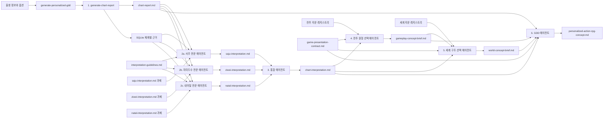

# 개인화 GDD 생성 파이프라인

## 목적

출생 정보를 결정론적 차트 보고서로 계산한 뒤 게임 창작을 위한 시드로 사용한다. 세 체계를 서로 격리된 전문 에이전트가 깊이 해석하고, 통합 에이전트는 전문 해석 사이의 일관성·구체화·상충을 정리하며, GDD 에이전트는 그 통합 문서만을 주 설계 브리프로 사용한다.

## 전체 흐름



세 전문 에이전트는 차트 보고서 생성 후 동시에 실행한다. 서로의 결과를 보지 않으며, 셋이 모두 검증을 통과한 뒤에만 통합 에이전트를 실행한다. 모든 에이전트는 `fork_turns="none"`으로 격리한다.

## 입력과 기본값

필수 입력은 생년월일, 정확한 출생 시각, 도시 수준 출생지, 성별이다. 지명이 모호할 때만 사용자에게 확인한다.

| 옵션 | 기본값 | 의미 |
| --- | --- | --- |
| `mode` | `light` | 전문 해석·통합·GDD의 분량과 깊이 |
| `purpose` | `experiment` | `regression`, `new-profile`, `incident-reproduction`, `release-candidate`도 허용 |
| `flow-year` | 실행 연도 | 자미두수 유년 계산 연도 |
| `jasi-method` | `unified` | 사주 자시 처리 방식 |
| `house-system` | `P` | 서양 점성술 하우스 시스템 |

## 버전과 출력

`.agents/artifact-series.json`의 활성 series 안에서 공용 예약기가 다음 patch를 할당한다.
차트 단독 생성과 전체 GDD는 같은 번호 순서를 공유한다. 명시적 버전 지정은 받지 않으며
실패·취소·비정상 종료된 실행의 번호도 재사용하지 않는다. 기존 아티팩트는 변경하지 않는다.

첫 예약이 공용 `artifacts/state.sqlite`를 초기화하고 실행·버전·단계 상태를 DB에 기록한다.
종류·목적·mode·기준선/source revision과 dirty 여부를 보존한다. 원시 출생 인자와 생성
본문은 운영 로그에 넣지 않는다. `release-candidate`는 clean working tree에서만 예약한다.
과거 아티팩트는 import하지 않고 기존 디렉터리 이름만 확인해 번호 충돌을 피한다.

```text
artifacts/vX.Y.Z/docs/GDD/
├── chart-report.md
├── saju-interpretation.md
├── ziwei-interpretation.md
├── natal-interpretation.md
├── chart-interpretation.md
├── gameplay-concept-brief.md
├── world-concept-brief.md
└── personalized-action-rpg-concept.md
```

## 단계 1: 차트 보고서

`generate-chart-report`가 사주팔자, 자미두수, 네이탈 차트를 계산해 `chart-report.md`에 그대로 저장한다. 동시에 같은 결정론적 출력에서 장식 구분선과 섹션 제목을 제외하고 내용 기반 해시 ID를 부여해 SQLite의 evidence에 저장한다. 해석이나 요약은 하지 않는다.

## 단계 2: 전문 해석 병렬 실행

세 `interpret-chart-system` 에이전트가 DB 입력 조회로 지정된 체계의 보고서·근거만 읽는다.

에이전트의 역할·입출력·격리·검증 절차는 스킬이 맡고, 해석 질문과 출력 템플릿은
`docs/prompts/saju-interpretation.md`, `ziwei-interpretation.md`, `natal-interpretation.md`가
각각 맡는다. 오케스트레이터는 선택 체계에 해당하는 프롬프트의 절대 경로만 전달한다.
공통 항목 형식·일곱 생활 질문·light/deep 기준은 `interpretation-guidelines.md`를 따른다.
각 에이전트는 템플릿의 질문을 실제 답으로 교체하며 기존 장 제목·항목 ID·근거 계약을 유지한다.
체계 고유 요소를 먼저 해석하고 그 결과로 생활 영역별 전문 항목을 종합한 뒤 개인별 부록을
붙인다. 부록의 중요한 결론도 전문 항목 ID에 연결해 통합 단계에서 추적할 수 있게 한다.

### 사주팔자

원국과 십신에 한정하지 않는다. 계산 전제, 네 기둥과 지장간·운성·공망, 모든 팔자 관계, 신살, 좌법, 인종법, 전체 대운을 다룬다. 보고서에 출력되지 않은 격국·신강약·용희신 등을 계산된 사실처럼 보충하지 않는다. 결과는 `saju-interpretation.md`이며 항목 ID는 `S-01`부터 시작한다.

### 자미두수

계산 전제, 명궁·신궁·오행국, 12궁의 모든 성요와 밝기·사화, 본명 사화, 전체 대한, 조회 유년과 12유월을 다룬다. 본명·대한·유년·유월 층위를 섞지 않는다. 결과는 `ziwei-interpretation.md`이며 ID는 `Z-01`부터 시작한다.

### 네이탈 차트

계산 전제, 출력된 앵글과 하우스, 모든 행성·노드·조건부 포인트, 별자리·도수·역행·하우스, 모든 주요 애스펙트와 오브를 다룬다. 출생 시각 미상이나 조건부 천체의 부재를 임의로 채우지 않는다. 결과는 `natal-interpretation.md`이며 ID는 `N-01`부터 시작한다.

각 전문 문서는 직접 관찰과 해석을 구분하고 게임 설계는 하지 않는다. 모든 전문 항목은 체계 고유의 `해상도:`를 기록한다. 사주는 원국 구조·관계 작용·운의 변화, 자미두수는 궁위 역할·성요 상태·시간 층위, 네이탈은 심리 기능·삶의 영역·내적 역동을 각각 보존한다. `근거:`에는 DB에 저장된 해당 체계의 evidence ID만 사용하며, 모든 evidence ID를 문서 전체에서 최소 한 번 참조한다. 원문 행이나 검토표는 복제하지 않는다.

## 단계 3: 통합 해석

`interpret-chart-report` 통합 에이전트는 세 전문 문서만 읽고 `chart-interpretation.md`를 만든다. 원본 보고서를 다시 해석하지 않는다.

통합 관계는 다음 네 종류로 분류한다.

- `일관`: 둘 이상의 체계가 유사한 방향을 독립적으로 지지한다.
- `구체화`: 한 체계의 넓은 해석을 다른 체계가 조건·영역·작동 방식으로 구체화한다.
- `상충`: 전제나 방향이 달라 하나의 결론으로 합치기 어렵다.
- `고유`: 한 체계만 제공하는 해상도를 독립된 재료로 보존한다.

통합 항목은 `I-01`부터 시작하며 `관계:`, `해석:`, `작동 사슬:`, `양면성:`, `조건:`, `근거:`를 포함한다. 근거는 실제 `S-`, `Z-`, `N-` ID만 참조하고 모든 전문 ID를 최소 한 번 사용한다. 상충은 임의로 화해시키지 않으며 고유 해석은 공통분모가 없다는 이유로 삭제하지 않는다. 통합 단계는 삶의 해석까지만 담당하고 창작 소재를 미리 선택하지 않는다.

## 단계 4: 전투 원형 선택

전투·세계 선택과 GDD는 공통 입력
[game-presentation-contract.md](../prompts/game-presentation-contract.md)의 정확한 절대 경로를
받는다. 각 단계 실행 전에 `bun scripts/game-presentation.ts <presentation-input>`으로
부재·빈 파일·계약 오류를 검사하고 전문을 읽는다. 독립 스킬 호출도 같은 입력이 필수다.
차트·해석 단계에는 전달하지 않으며 생성 중 공통 조건을 개인 성향으로 바꾸지 않는다.

`select-gameplay-concept`는 통합 해석에서 일곱 게임플레이 성향 축을 추출하고 구조적으로
다른 후보 네 개를 비교한다. 후보는 해석 ID, 반대 근거, 약점과 점수를 포함하며 모든
후보 쌍은 최소 세 축에서 달라야 한다.

최초 선택이 DB의 성공 확정된 전투 지문과 일곱 축
중 다섯 축 이상 같으면 다섯 번째 후보를 한 번 추가해 다시 비교한다. 과거 GDD 본문은
읽지 않는다. 결과는 `gameplay-concept-brief.md`에 저장한다.

모든 후보는 공통 계약 안의 조작과 성장 변화를 기존 core-loop·growth-path에 설명하고
선택 전에 의미 검토한다. 브리프 끝에는 공통 `game-presentation` 블록을 정확히 한 번 선언한다.

## 단계 5: 독립된 세계 구조 선택

`select-world-concept`는 통합 해석과 확정 전투 브리프를 읽고 지형·생태·이동·정착·위험·
공간 규칙의 6축으로 서로 다른 세계 네 개를 비교한다. 해석 ID, 반대 근거, 전투 동사의
환경별 번역, 탐험·해금·귀환 방식을 기록한다. anchor·route·flow를 곧바로 닻·항로·조류로
문자화하지 않는다. 세계 지문은 같은 DB 안에서 전투와 분리된 종류로 조회·비교한다.

처음 후보 쌍은 최소 3축이 달라야 하고, 최소 세 지형과 비핵심 해양 대안 두 개를 포함한다.
기존 세계와 4축 이상 같으면 추가 후보 한 개를 비교한다. 해양 세계와 유사 세계는 금지하지
않으며 재선택 시 해석 적합성, 비해양 대안과의 비교, 실제 공간 플레이 차이를 기록한다.
최종 결과는 `world-concept-brief.md`다. 전체 계약은
[세계 구조 선택 명세](../spec/world-concept-selection.md)를 따른다.

모든 세계 후보는 같은 화면에서 공간 연결·높이·가림과 전투 동사를 설명한다.
세계 브리프도 `world-concept` 밖에 공통 `game-presentation` 블록을 정확히 한 번 선언한다.
공통 화면 조건은 세계 지문 축이나 다양성 점수에 포함하지 않는다.

## 단계 6: GDD

`generate-gdd-from-interpretation`은 통합 해석을 주 설계 브리프로, `chart-report.md`를 근거
확인용으로, `gameplay-concept-brief.md`의 선택 후보를 고정 전투 계약으로,
`world-concept-brief.md`의 선택 후보를 고정 세계 계약으로 사용한다. GDD에는
원본 보고서나 해석 문서를 첨부하지 않으며 탈락 후보를 섞거나 전투 원형을 다시 고르지
않는다.

GDD는 통합 해석의 표면 직업·업무 명사를 옮기지 않고, 그 아래의 동기·갈등·행동 패턴·발현 조건을 추상화한 뒤 독립적인 Action RPG 판타지로 재창작한다.

GDD의 `world-structure` JSON block은 선택된 6축의 값과 구체적 공간 구현을 선언한다.
validator는 이 선언의 일치와 누락을 검사하며 자연어 본문의 의미적 일치는 생성 에이전트가
검토한다. 해양 단어의 개수로 세계를 판정하지 않는다.

GDD는 공통 계약의 화면·픽셀 표현, 이동·타격·높이·가림, 기본 공격·방어 피드백,
다수 적과 보스의 가독성, 빌드 변화 및 구현 우선 조우를 설명한다. 공통
`game-presentation` 블록을 정확히 한 번 선언하고 두 브리프의 선언도 검증한다.

## 데이터 격리

| 데이터 | 차트 생성 | 전문 3개 | 통합 | 전투 선택 | 세계 선택 | GDD |
| --- | :---: | :---: | :---: | :---: | :---: | :---: |
| 원시 출생 정보·옵션 | 읽기 | 미전달 | 미전달 | 미전달 | 미전달 | 미전달 |
| `chart-report.md` | 생성 | 각자 지정 체계 읽기 | 미전달 | 미전달 | 미전달 | 근거 확인 |
| DB의 체계별 evidence | 생성 | 각자 지정 체계 ID 읽기 | 미전달 | 미전달 | 미전달 | 미전달 |
| 전문 해석 3개 | 미전달 | 각자 생성·상호 미전달 | 읽기 | 미전달 | 미전달 | 미전달 |
| `chart-interpretation.md` | 미전달 | 미전달 | 생성 | 주 입력 | 주 입력 | 주 입력 |
| 전투 지문 레지스트리 | 미전달 | 미전달 | 미전달 | 지문만 읽기 | 미전달 | 미전달 |
| 세계 지문 레지스트리 | 미전달 | 미전달 | 미전달 | 미전달 | 지문·공간 요약만 읽기 | 미전달 |
| `gameplay-concept-brief.md` | 미전달 | 미전달 | 미전달 | 생성 | 전투 계약 | 전투 계약 |
| `world-concept-brief.md` | 미전달 | 미전달 | 미전달 | 미전달 | 생성 | 세계 계약 |
| 공통 `game-presentation-contract.md` | 미전달 | 미전달 | 미전달 | 필수 입력 | 필수 입력 | 필수 입력 |
| 대화 문맥·과거 GDD | 미전달 | 미전달 | 미전달 | 미전달 | 미전달 | 미전달 |

## 모델 선택

| 단계 | `light` | `deep` |
| --- | --- | --- |
| 차트 생성 | `gpt-5.6-terra`, low | `gpt-5.6-terra`, low |
| 전문 해석 3개 | `gpt-5.6-terra`, low | `gpt-5.6-sol`, high |
| 통합 해석 | `gpt-5.6-terra`, low | `gpt-5.6-sol`, high |
| 전투 원형 선택 | `gpt-5.6-terra`, low | `gpt-5.6-sol`, high |
| 세계 구조 선택 | `gpt-5.6-terra`, low | `gpt-5.6-sol`, high |
| GDD | `gpt-5.6-terra`, low | `gpt-5.6-sol`, high |

## 검증과 실패 처리

공통 화면 입력과 선언은 `scripts/game-presentation.ts`를 사용해 검사한다. 전투 validator의
네 번째, 세계 validator의 다섯 번째, 두 GDD validator의 여섯 번째 인수는 공통 입력 경로다.
생략하거나 빈 문서를 전달하면 실패한다. 세 산출물의 선언은 공통 고정 값과 같아야 한다.
등록 CLI도 잘못된 선언을 거부하며 기존 레지스트리 항목은 변경하지 않는다.

선언 검사는 자연어 본문의 의미 검토를 대신하지 않는다. 생성 단계는 선언과 실제 조작·
카메라·아트가 충돌하거나 가독성·제작 범위가 불충분하면 기존 1회 수정 한도 안에서 보완하고,
해결되지 않으면 실패를 반환한다. 미해결 의미 검토 실패 후에는 종속 생성·지문 등록·성공
처리를 진행하지 않는다. 최종 검증은 유효한 단계 결과를 임의로 고치지 않는다.
수용 사례와 검증 범위는 [공통 화면·아트 명세](../spec/game-presentation-contract.md)를 따른다.

각 전문 문서는 evidence manifest의 해당 체계 ID가 모두 참조됐는지, 존재하지 않는 ID를 사용하지 않았는지, 순차 전문 ID와 `해석:` 계약을 충족하는지 검증한다. Markdown 장식, 공백, 구분선, 원문 행 복사는 검증 대상이 아니다. 통합 문서는 세 비교 분류, 순차 ID, 관계 유형, 서로 다른 두 체계 이상의 실제 전문 ID 참조를 검증한다. 원형 선택 문서는 후보 수, 축 값, 후보 간 거리, 해석 ID, 점수 선택, 지문 유사도와 추가 후보 조건을 검증한다. GDD는 통합 ID 추적성, 원본 보고서 비첨부와 선택 지문 일치를 검증한다.

오케스트레이터는 DB에서 run을 시작하고 선행 조건이 충족된 시도만 prepare한다.
각 외부 agent 실행 직전에 dispatch를 기록하고 반환된 agent ID를 bind한다. 제출은 stdin으로
기록하며 finish가 같은 snapshot을 검증한다. 에이전트의 자체 수정 루프는 허용하지 않는다.

전문 해석의 최초 생성·수정·재생성은 체계당 총 3회 한도를 공유한다. 구조 검증 통과는
`editing-required`이며 방어 편집 채택 후에만 정식 문서를 게시한다. 편집은 별도 총 3회
한도에서 제출 실패 시에만 sentence→item→system으로 확대한다. 원본·입력·hash 변조와
기록·게시 오류를 제출 오류로 바꾸지 않는다.

시도 입력·결과·진단·채택과 작업 이력은 DB에 기록한다. 시도별 Markdown은 garbage에
보존하되 후속 설계 입력에 섞지 않는다. 파일 게시 의도와 hash를 DB에 먼저 남기고,
게시 후 DB 완료 전에 중단되면 reconcile이 같은 파일을 확인해 완료를 반영한다.

일시적 인프라 장애·입력 대기·실행 여부 불명은 blocked로 남기고 새 컨텍스트에서 DB의
summary/next를 조회해 재개한다. worker가 살아 있거나 종료를 확인할 수 없으면 중복
호출하지 않는다. 제출이 저장됐으면 재생성 없이 검증·게시부터 이어 간다. 사용자 취소와
회복 불가능한 실패는 terminal이며 종료 run은 다시 열지 않는다.

최종 검증 snapshot과 최신 지문 revision을 확인한 뒤 두 종류 지문과 run 성공을 한 DB
트랜잭션으로 확정한다. 부분 등록은 rollback한다. 비교 이후 다른 run이 등록했으면
registry-stale로 차단하고 최신 비교와 필요한 선택·의존 문서의 재검토를 요구한다.
상세 CLI·재개·예산·입력 격리 계약은
[SQLite 상태 관리와 작업 재개 명세](../spec/sqlite-artifact-state.md)를 따른다.

## 완료 결과

새 run은 JSON/JSONL 상태 파일이나 루트 TODO를 생성하지 않는다. 진행과 다음 행동은
읽기 CLI에서 조회하며 전체 DB나 운영 이력을 하위 설계 입력으로 전달하지 않는다.

성공 시 모드, artifact version, purpose, DB의 최종 상태, 검증된 여덟 Markdown 산출물
경로와 DB 경로, 모델 대체 여부를 보고한다. 출생 정보와 산출물 본문은 완료 메시지에
복제하지 않는다. 로컬 경로는 실행 안내이며 영구 검증 근거로 사용하지 않는다.
