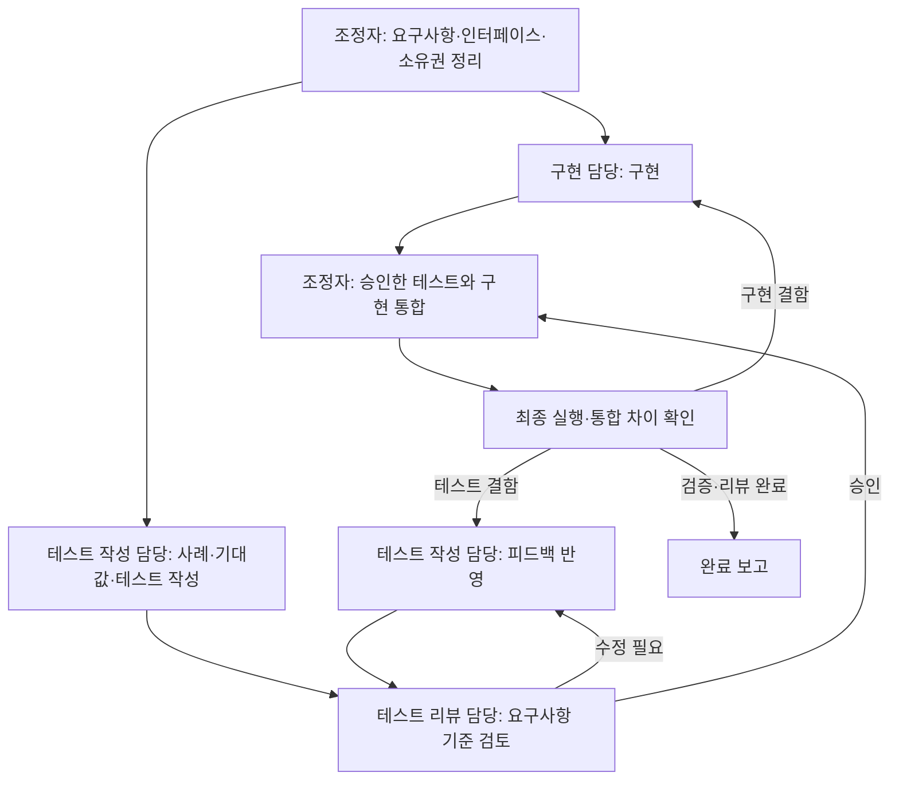

# 구현·테스트 작성·테스트 리뷰의 3개 에이전트 작업 흐름

> 상태: 구현 완료 — 프로젝트 지침·개발 스킬 연결 및 3개 역할의 통제된 수용 검증 완료
> 작성일: 2026-11-06
> 범위: 저장소의 코드 구현과 테스트 작성 방식

## 1. 목적과 적용 범위

구현자가 정한 가정을 구현자 자신의 테스트로 재확인하는 문제를 줄인다. 구현, 테스트
작성, 테스트 리뷰를 서로 다른 에이전트에 맡긴다. 구현은 테스트 작업과 병렬로 진행하고,
테스트 작성 → 리뷰 → 피드백 반영 → 재검토는 직렬로 진행한다.

테스트 통과는 정해진 동작의 확인이다. 테스트의 기대값이나 제품 정책의 타당성까지
자동으로 증명하지 않는다. 리뷰는 코드가 테스트를 통과하는지와 함께, 테스트가 사용자의
요구를 올바르게 판정하는지도 확인한다.

사용자가 `$implement-with-test-review` 또는 이 다중 에이전트 작업 방식을 명시적으로
요청했을 때만 적용한다. 일반 코드 수정은 단일 에이전트가 처리한다. 필요하면 사용을
제안할 수 있지만 동의 전에 작업 에이전트를 호출하지 않는다. 다른 명세의 이 작업 흐름
참조도 자동 실행을 허용하지 않는다.

명시적으로 요청된 경우 새 기능, 버그 수정, 리팩터링, 생성 결과를 판정하는 validator의 변경에 적용한다.
테스트 추가·수정 자체가 과제인 경우에는 해당하는 두 테스트 역할을 사용하고 구현
담당에게 불필요한 코드 변경을 만들지 않는다. 문서만 바꾸는 작업에는 3개 에이전트를
강제하지 않고 기존 문서 검사를 따른다.

이 명세는 개발 작업의 역할 분리다. GDD 생성 시 차트·전문 해석·통합·설계를 격리하는
기존 파이프라인과는 별개이며 그 에이전트 수, 재시도 예산, run 상태를 변경하지 않는다.
기존 테스트 전체를 즉시 재작성하거나 현재 실패한 생성 결과를 수정하는 작업도 포함하지 않는다.

## 2. 역할과 권한

상위 에이전트는 조정자이고, 다음 세 작업 에이전트를 각각 별도로 실행한다.
즉 작업 역할은 3개이며 조정자를 포함하면 동시에 최대 4개 에이전트다.

| 역할 | 책임 | 수정 범위 | 완료 보고 |
| --- | --- | --- | --- |
| 구현 담당 | 요구 동작 구현, 기존 코드와의 호환성 확인, 구현 결함 수정 | 제품 코드·필요한 설정 및 구현 문서 | 변경 파일, 구현한 동작, 알려진 한계 |
| 테스트 작성 담당 | 요구사항에서 사례와 기대값 도출, 테스트·fixture 작성, 리뷰 반영 | 테스트 코드·테스트 전용 fixture·보조 코드 | 요구사항과 테스트의 대응, 기대값 근거, 실행 결과, 피드백 처리 |
| 테스트 리뷰 담당 | 테스트의 타당성·누락·오탐·실패 진단 검토, 수정 후 승인 여부 판정 | 기본적으로 읽기 전용 | 지적 사항, 근거, 필요한 수정, 승인 여부 |

조정자는 입력 계약, 파일 소유권, 진행 순서, 통합과 최종 검증을 관리한다. 테스트를
통과시키려고 직접 기대값을 낮추거나 테스트 역할을 대신 수행하지 않는다. 구현 결함은
구현 담당에게, 테스트 결함은 테스트 작성 담당에게 돌려보낸다. 리뷰 담당은 지적한 테스트를
직접 고친 뒤 자신의 변경을 승인하지 않는다.

동일 에이전트에게 역할 이름만 바꾸어 세 역할을 수행시키지 않는다. 서로 다른 모델을
사용하는 것은 필수가 아니며, 모델이 다르다는 사실만으로 판정 기준의 독립성이 보장되지 않는다.

## 3. 공통 입력과 독립성

조정자는 작업 시작 전에 다음 공통 입력을 정리한다.

- 사용자의 목표와 명시된 제약, 관련 spec·ADR의 정확한 경로
- 관찰 가능한 기대 동작과 허용·거부 사례, 작업 범위 밖의 항목
- 현재 기준 revision과 보존해야 하는 기존 변경
- 공개 함수·CLI·파일 형식 등 테스트가 호출할 인터페이스와 기존 테스트 실행 방법
- 역할별 쓰기 가능 파일, 공유 설정 파일의 담당자, 알려진 미결정 사항

인터페이스는 기존 계약을 우선 사용한다. 새 인터페이스가 필요하면 조정자가 요구사항에
맞는 최소 계약을 정리해 구현 담당과 테스트 작성 담당에게 동시에 전달한다. 내부 함수
이름이나 알고리즘을 테스트가 강제하도록 상세 구현까지 정하지 않는다.

각 작업 에이전트는 `fork_turns="none"`으로 시작하며 필요한 과제와 경로만 받는다.
공통 입력에 조정자가 추측한 정답이나 구현자의 설계 결론을 요구사항처럼 끼워 넣지 않는다.
테스트 리뷰 담당에게는 요구사항·테스트와 필요한 기준 코드·공개 인터페이스를 전달하고,
첫 검토 전에 구현자의 완료 주장이나 테스트 작성자의 자기 승인 의견을 정답으로 전달하지 않는다.

테스트 작성 담당은 먼저 요구사항과 기준 코드에서 사례·기대값을 정한다. 새 구현의
분기나 상수를 보고 기대값을 역산하지 않는다. 이후 실제 실행과 원인 분석을 위해 새
구현을 읽을 수 있지만, 달라진 결과를 곧바로 새로운 정답으로 채택하지 않는다.

공유 파일 시스템에서는 다른 에이전트의 파일을 볼 수 있으므로 이것을 기술적으로 완전한
차단이라고 부르지 않는다. 독립성은 입력 분리·역할별 소유권·요구 근거 기록으로 확보한다.

## 4. 실행 순서

1. 조정자가 공통 입력과 파일 소유권을 정한 뒤 구현 담당과 테스트 작성 담당을 병렬로 시작한다.
2. 테스트 작성 담당이 사례와 테스트를 완성해 리뷰 가능한 버전을 인계한다. 새 구현이
   미완료여도 리뷰를 시작할 수 있다. 이때 실패 원인이 미구현인지 테스트 실행 오류인지 구분한다.
3. 리뷰 담당이 요구 동작, 기대값 근거, 실제 테스트 코드를 함께 검토한다. 구현 완료를
   기다리지 않고 테스트 자체를 평가하되 실행하지 못한 항목은 명시한다.
4. 수정 요청이 있으면 테스트 작성 담당이 반영한다. 리뷰와 해당 테스트의 수정은 동시에
   진행하지 않는다. 수정한 버전을 다시 리뷰 담당에게 전달한다.
5. 리뷰 담당은 지적 사항의 처리와 수정으로 생긴 영향 범위를 확인한다. 수정 반영 보고만으로
   승인하지 않으며, 근거 있는 이견은 요구사항과 대조해 판정한다.
6. 구현 완료와 테스트 승인이 모두 준비되면 통합해 실행한다. 구현 문제는 구현 담당이
   수정하며 테스트 기대값은 유지한다. 테스트 문제로 판단되면 작성·리뷰 경로를 다시 거친다.
7. 리뷰 담당이 최종 통합본의 테스트 차이와 실행 근거를 확인하고 조정자가 완료 조건을 판정한다.

리뷰 승인은 인계된 테스트 버전에만 유효하다. 이후 테스트·fixture·assertion·mock·스냅샷
또는 테스트 실행을 바꾸는 설정이 달라지면 영향 부분의 재검토가 필요하다. 공개 인터페이스나
요구사항이 달라지면 구현·테스트 양쪽에 같은 변경을 전달하고 기존 승인 적용 여부를 다시 판단한다.

## 5. 파일 소유권과 병렬 작업

기본은 같은 작업 공간에서 수정 파일을 분리하는 방식이다. 구현 담당은 테스트 파일을,
테스트 작성 담당은 제품 코드를 수정하지 않는다. 리뷰 담당은 파일을 수정하지 않는다.
테스트 전용 helper를 제품 코드에 넣거나 테스트가 기대하는 인터페이스를 몰래 추가하지 않는다.

`package.json`, 공용 설정, 제품 코드와 테스트가 섞인 파일 등 동시 수정 가능성이 있는
파일은 시작 전에 한 담당자에게 배정한다. 다른 역할은 필요한 변경을 요청한다. 깔끔한
분리가 어려운 파일은 해당 편집만 직렬화하거나 별도 checkout으로 격리한다. 작업 전체를
분리하기 위해 불필요한 파일 이동·추상화를 추가하지 않는다.

테스트 인계 시 파일 목록과 diff 또는 revision 등 검토 대상을 식별할 정보를 남긴다.
리뷰·최종 실행 중 해당 테스트 버전을 바꾸지 않는다. 병렬 구현이 실행 결과에 영향을 줄
수 있으면 고정된 사본에서 실행하거나 구현 담당의 쓰기를 잠시 멈춘 뒤 실행한다.
서로 다른 시점의 파일로 얻은 테스트 통과를 최종 결과로 보고하지 않는다.

## 6. 테스트 작성 정책

테스트 작성 담당은 각 주요 사례에 요구사항 근거, 입력 조건, 기대 동작과 실패 시 영향을
설명한다. 같은 근거를 공유하는 테스트들은 묶어서 설명할 수 있으며 별도 범용 관리 시스템을
만들지는 않는다. 요구사항으로 설명할 수 없는 판정 기준은 미결정 사항으로 보고한다.

| 구분 | 작성 기준 |
| --- | --- |
| 정상 동작 | 허용되는 사례가 통과하며 사용자가 기대한 결과를 얻는다. |
| 오류 동작 | 잘못된 입력·상태를 거부하고 필요한 진단과 부수 효과 보존을 확인한다. |
| 경계·오탐 | 정상적인 짧은 표현, 부정문, 선택적 값 등 거부하면 안 되는 사례를 함께 확인한다. |
| 회귀 | 수정 대상 문제를 합성 입력으로 재현하고 의도한 이유로 실패·통과하는지 확인한다. |
| 통합 | 공개 CLI·모듈 경계와 실제 저장·등록 등의 연결을 확인하고 mock이 가리는 범위를 밝힌다. |
| 의미 품질 | 실제 해석 깊이·재미·가독성처럼 자동 판정하지 못하는 부분은 별도 수용 검토로 표시한다. |

구현의 출력이나 상수를 그대로 복사해 기대값으로 쓰지 않는다. 독립적으로 계산·정의한
기대값이나 요구사항에서 도출한 불변조건을 사용한다. 테스트 대상 parser가 생성한 값을
다시 같은 parser로 읽는 것만으로 외부 계약과의 일치를 증명하지 않는다.

숫자·길이·금지어를 실패 기준으로 삼을 때는 그 기준이 사용자 요구나 승인된 정책에
명시되어 있는지 확인한다. 설명이 길면 깊고 짧으면 얕다는 가정만으로 새 임계값을
만들지 않는다. 이미 명시된 기준도 이번 작업과 관련된 부당한 거부를 만든다면 리뷰
지적으로 남기며 구현자가 임의로 유지·삭제를 확정하지 않는다.

품질의 대리 지표는 측정 대상과 한계를 명시한다. 경고로 충분한 관찰과 전체 작업을
중단시킬 계약 위반을 구별한다. 빈 항목·없는 근거 ID와 짧지만 완결된 설명을 같은 결함으로
취급하지 않는다. 근거 없는 대리 지표를 편의상 필수 통과 조건으로 승격하지 않는다.

오류 검사에서는 가능하면 코드·위치·종류 등 의도한 진단을 확인한다. 단순히 `false`나
실패 종료를 확인할 때는 관련 없는 오류로도 테스트가 통과하는지 검토한다. 버그 수정은
변경 전 실패·변경 후 통과를 확인하고, 리팩터링은 기존 관찰 동작을 보존한다.

합성 자료는 [로컬 아티팩트와 영구 문서의 경계](local-artifact-document-boundary.md)를
따른다. 실제 개인 입력이나 과거 로컬 결과가 없어도 회귀를 실행할 수 있어야 한다.
수동 평가 fixture의 존재를 자동 의미 검증이나 실제 모델 품질의 검증 완료로 보고하지 않는다.

## 7. 리뷰 정책과 결과

리뷰 담당은 다음 질문을 기준으로 검토한다.

- 기대값을 사용자 요구와 연결할 수 있는가? 구현자의 가정을 정답으로 만든 부분은 없는가?
- 테스트 이름이 주장하는 범위와 assertion이 실제로 확인하는 범위가 일치하는가?
- 정상 사례도 부당하게 거부하는 기준, 빠진 경계·반례는 없는가?
- 잘못된 동작이 남아도 통과할 수 있는가? fixture·mock이 제품 결함을 가리고 있지는 않은가?
- 실패는 의도한 이유이며 수정 가능한 진단을 제공하는가?
- 격리·재현성·기존 변경 보존이 지켜졌는가? 검토한 버전과 실행한 버전이 같은가?
- 구조 계약 검사와 실제 의미 품질 평가가 구분되어 있는가?

지적 사항은 대상, 문제, 요구사항 근거, 예상 영향, 필요한 수정 또는 확인을 포함한다.
결과는 `승인`, `수정 필요`, `요구사항 확인 필요`로 구분한다. 실행하지 못한 항목과
검증 한계도 별도로 남긴다. 필수 검증을 못 했는데 단순 승인으로 완료 처리하지 않는다.

테스트 작성 담당은 지적마다 수정 내용 또는 미반영 이유와 근거를 회신한다. 미반영
의견이 있다고 자동 실패시키거나, 반영했다고 자동 승인하지 않는다. 리뷰 담당이 다시
판정하고 해결되지 않은 차이는 조정자에게 올린다.

## 8. 실패·이견·중단 처리

테스트 실패를 구현 결함, 테스트 결함, 요구사항 모호성, 실행 환경 문제로 구분한다.
요구사항이 명확하면 조정자가 근거를 대조해 해당 담당자에게 수정을 요청한다.
모호한 요구나 새로운 제품 정책 결정이 필요할 때만 사용자에게 질문한다. 테스트를
통과시키기 위한 assertion 삭제, 무근거한 skip, 스냅샷 일괄 갱신으로 해결하지 않는다.

반복 검토에서 같은 이견이 진전 없이 남거나 실행 환경 문제를 해결할 수 없으면 미완료
상태와 근거를 보고한다. 정해진 회차를 채웠다는 이유로 승인하거나 무제한으로 반복하지
않는다. 구체적인 비용·시간 한도는 과제 시작 시 필요한 경우 정하며 기존 생성 스킬의
재시도 숫자를 이 개발 작업에 그대로 가져오지 않는다.

에이전트 장애·컨텍스트 교체 시 같은 역할에만 후속 작업을 맡기고 입력과 수정 소유권을
유지한다. 리뷰 담당이 테스트 작성자로 전환해 자신의 변경을 승인하지 않는다. 진행 기록에는
역할별 에이전트, 인계 버전, 리뷰 결과, 반영 여부, 실행 명령·결과와 남은 문제를 남긴다.
현재 과제의 로컬 기록은 새 GDD 버전 manifest나 영구 근거 자료로 취급하지 않는다.

## 9. 완료 조건과 보고

- 구현·테스트 작성·테스트 리뷰가 서로 다른 에이전트에서 수행됐다.
- 구현과 테스트 작업은 병렬로 진행했고 테스트 인계·리뷰·수정은 직렬로 처리됐다.
- 주요 테스트의 요구 근거와 기대값이 설명됐고 관련 정상·오류·오탐 사례가 검토됐다.
- 리뷰 지적 사항이 처리되고 최종 통합본에 해당하는 승인이 있다.
- 과제에 맞는 테스트와 필수 검사가 최종 통합본에서 통과했다.
- 의미 품질 등 자동 검증하지 않은 범위와 알려진 한계가 명시됐다.
- 파일 소유권·기존 변경·개인정보와 로컬 아티팩트의 경계를 지켰다.

완료 보고는 역할별 수행 주체, 핵심 변경, 리뷰·반영 결과, 실행한 검증과 한계를 요약한다.
테스트 수나 에이전트 수만으로 품질을 보장했다고 표현하지 않는다. 커밋·배포는 기존 사용자
요청과 권한 범위를 따르며 이 작업 흐름 자체가 새 권한을 부여하지 않는다.

## 10. 도입 순서와 수용 검증

1. `AGENTS.md`에 구현·테스트 작성·리뷰의 역할과 병렬·직렬 순서를 연결한다.
   - 검증: 같은 역할의 에이전트가 구현과 테스트를 동시에 맡도록 하는 지침이 없다.
2. 필요하면 개발 작업용 스킬에 공통 입력, 소유권, 인계·리뷰·최종 검증 절차를 담는다.
   - 검증: 기존 생성 스킬을 개발 오케스트레이터로 바꾸거나 불필요한 자동 스케줄러를 추가하지 않는다.
3. 개인정보 없는 작은 구현 과제로 세 역할의 작업을 통제해 시험한다.
   - 검증: 구현 진행 중 테스트 작성·리뷰가 진행되고, 수정 요청은 작성 담당이 반영한 뒤 재검토된다.
4. 의도적으로 잘못된 테스트와 구현을 포함한 수용 사례를 확인한다.
   - 검증: 아래 사례가 올바른 담당자에게 돌아가며 부당한 테스트를 통과 기준으로 승인하지 않는다.
5. 도입 결과와 실제 한계를 기록하고 문서 검사를 실행한다.
   - 검증: `bun run check:docs --review`의 오류와 검토 후보를 확인한다.

| 합성 수용 사례 | 기대 동작 |
| --- | --- |
| 요구에 없는 최소 글자 수를 테스트가 추가 | 리뷰에서 판정 근거를 요구하고 임의의 실패 조건은 승인하지 않음 |
| 짧지만 완결된 설명과 길지만 무의미한 설명 | 길이만으로 의미 품질을 판정하지 않고 적절한 검토 범위로 분리 |
| 구현이 잘못된 값을 반환하고 테스트가 그 값을 복사 | 요구사항에서 기대값을 다시 도출하도록 수정 요청 |
| 올바른 테스트가 실제 구현 결함을 검출 | 구현 담당이 수정하며 테스트 기대값을 낮추지 않음 |
| 이름은 통합 테스트지만 함수 하나만 실행 | 범위를 바로잡거나 실제 경계 검증을 추가하도록 요청 |
| 승인 후 fixture·assertion이 변경 | 기존 승인을 그대로 쓰지 않고 영향 부분 재검토 |
| 테스트 수정 중 리뷰 담당이 이전 파일을 실행 | 검토·실행 버전을 고정한 뒤 결과를 다시 확인 |

문서의 존재만으로 역할 분리가 수행됐다고 보지 않는다. 아래 도입 검증과 별개로 이후
과제에서도 역할 배정·인계·리뷰·수정·최종 실행을 실제로 확인해야 한다.

## 11. 구현 결과와 검증 범위

### 프로젝트 연결

- [AGENTS.md 제4절](../../AGENTS.md)에 코드 구현 조정자의 역할 분리와 실행 순서를 연결했다.
- [implement-with-test-review](../../.agents/skills/implement-with-test-review/SKILL.md)를 개발용
  스킬로 추가했다. 공통 입력, 파일 소유권, 격리된 작업자, 버전 인계, 피드백 반영,
  재검토·최종 검증과 중단·인계를 안내한다.
- 배정받은 작업자는 자기 역할만 수행하며 새 팀을 재귀 생성하지 않는다. 테스트 전용은
  두 역할, 문서 전용은 기존 문서 검사로 분리한다. 기존 GDD 생성 스킬은 변경하지 않았다.
- [합성 수용 자료](../../scripts/fixtures/three-agent-workflow-cases.json)는 요구 없는 길이
  제한, 구현 출력 복사, 실제 구현 결함, 통합 검증 주장, 승인·실행 버전 불일치를 비교한다.
  JSON을 파싱하거나 보관했다는 사실을 행동 검증 통과로 취급하지 않는다.

### 통제된 개발 과제

제품 기능 추가 없이 임시 작업 공간에서 다음 공개 계약으로 세 역할을 시험했다.
이 설명은 재실험에 사용할 수 있는 합성 과제이며 특정 로컬 파일의 보존을 요구하지 않는다.

- 인터페이스: `normalizeLabel(input: string): string`
- 앞뒤 공백만 제거하고 내부 공백·탭·줄바꿈과 대소문자를 유지한다.
- 한 글자를 포함한 비어 있지 않은 문자열은 유효하다.
- 제거 후 빈 문자열이면 `Error`를 던지며 메시지는 정확히 `EMPTY_LABEL`이다.
- 기준 구현은 입력을 그대로 반환한다. 최소 길이·파일 저장·타입 바깥 입력 처리는 범위 밖이다.

구현 담당은 프로젝트 지침·스킬과 합성 함수만, 테스트 작성 담당은 테스트·fixture·검토
후보만 수정했다. 두 담당자의 실행이 겹치는 것을 조정자가 확인했다. 작성 담당이 먼저
기대값을 요구사항에서 정하고 테스트 버전을 고정한 뒤 읽기 전용 리뷰 담당에게 인계했다.

리뷰 담당은 실행 suite와 별도로 제시한 후보 검증 자료에서 한 글자 거부, 실행 출력의
기대값 재사용, 함수 테스트의 파일 저장 검증 주장, 이전 승인으로 변경본 완료 주장을
지적했다. 실행 suite의 기대값은 적절하다고 판정했다. 리뷰 종료 뒤 작성 담당이 후보
자료를 수정하고 재인계했으며, 리뷰 담당이 실제 수정과 버전을 대조해 재승인했다.
의도적으로 부적절한 후보를 실행 suite에 넣어 통과시키지는 않았다.

작성 담당과 리뷰 담당이 같은 테스트를 기준·최종 합성 구현에서 실행해 각각
2개 통과·10개 실패와 12개 통과·0개 실패를 확인했다. 실패는 공백 처리와 빈 결과 진단의
요구 위반으로 발생했고 최종 구현에 맞춰 기대값을 낮추지 않았다. 리뷰 담당은 실행 전후
제품·테스트·검토 자료의 파일 해시를 대조했다. 조정자도 같은 최종본의 12개 테스트 통과와
이전 작업의 변경 파일이 담당 범위 밖에서 바뀌지 않았음을 확인했다.

저장소 검증은 `bun run test`의 20개 파일·158개 테스트 통과, 문서 검사 오류 0개,
새 스킬의 `quick_validate.py` 통과와 `git diff --check` 통과를 확인했다.
`bun run check:docs --review`의 기존 후보 10개는 버전 정책·가상 예제·과거 문제 설명이며
이번 변경에 새 로컬 아티팩트 의존을 추가하지 않았다.

### 한계

이 도입은 스킬과 프로젝트 지침에 따른 에이전트 조정이다. 역할·순서·승인을 자동으로
강제하는 새 스케줄러나 상태 머신은 추가하지 않았다. 합성 함수 테스트의 통과는 해당
함수 계약의 검증이며 에이전트 행동·리뷰 판단·실제 해석 품질의 자동 검증이 아니다.
통제된 과제의 실행 결과는 도입 당시 관찰이고, 영구 회귀 자료는 위 합성 사례와 판정
기준이다. 임시 코드·테스트·진행 기록을 커밋된 자동 회귀 suite로 주장하지 않는다.

이번 작업은 기존 검사 전체의 타당성 리뷰나 최소 글자 수 정책 변경이 아니다.
그러한 후속 변경에도 같은 구현·테스트 작성·독립 리뷰 흐름을 적용한다.
